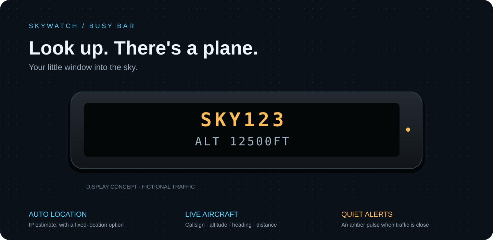

# Skywatch

**Look up. There's a plane.** A standalone aircraft spotter for [BUSY Bar](https://busy.app), with automatic location and a download-and-install app package.



[Download the latest .tgz](https://github.com/unipheas/skywatch/releases/latest/download/app.unipheas.skywatch.tgz) · [Releases](https://github.com/unipheas/skywatch/releases) · [Report an issue](https://github.com/unipheas/skywatch/issues)

## Install

1. Use BUSY Bar firmware **1.3.1 or newer**, with HTTP API **27.12.0+**, and connect the bar to Wi-Fi.
2. Download **`app.unipheas.skywatch.tgz`** from the release above. Leave it compressed; GitHub's source-code archives are not installable apps.
3. Connect the bar over USB and open **http://10.0.4.20**, or use its local Wi-Fi web interface.
4. Open **Apps → Add app → Select file**, upload the `.tgz`, then choose **Install app**.
5. Start **Skywatch**. It estimates your location automatically and begins scanning. No account, API key, companion computer, or server is needed.

The app must be running to monitor traffic; BUSY Bar runs one JS app at a time. It does not change your BUSY timer, volume, or brightness.

## What you see

The callsign stays on the top row. The second row changes every three seconds:

| Example | Meaning |
| --- | --- |
| `~0.7NM NE` | Horizontal distance and direction **from you to the aircraft**. `~` marks approximate IP location. |
| `ALT 12500FT` | Reported barometric altitude, **not height above your home**. `GEO` indicates geometric altitude when barometric altitude is absent. |
| `HDG 092 E` | Direction the aircraft is traveling: ground track in degrees from true north. |
| `310KT LEVEL` | Ground speed and climb/descent trend. |
| `N123SW B738` | Registration and ICAO aircraft type, when available. |
| `OVERHEAD` | Inside the configured horizontal radius of your **fixed** location. With automatic location, this reads `~NEAR IP LOC`. |

Airline flights usually supply a callsign such as `UAL123`; that is not always the marketed flight number such as `UA123`. Skywatch shows the broadcast identifier without inventing an airline, route, or destination. Missing fields remain unknown. A registration or transponder address replaces an absent callsign.

Nearby aircraft are cyan. Aircraft inside the overhead radius are amber, and a new arrival can pulse the status LED. The same aircraft alerts at most once per ten minutes. Alerts are visual and silent. The nearest aircraft is selected automatically; new overhead traffic takes priority unless you hold a selection. Up to 12 nearest aircraft are kept.

## Controls

| Control | Action |
| --- | --- |
| Turn wheel | Browse aircraft; hold the selection (`H` prefix). |
| Press OK | Advance the detail page. |
| Hold OK | Show/hide location, data-source attribution, and effective search radius. |
| Start / Pause | Toggle holding the selected aircraft. Data continues refreshing. |
| Back | Quit. |

## Location and settings

Open **Apps → Skywatch → Setup** in the bar's web interface. Restart Skywatch after changing settings.

**Automatic location is the default.** It uses [ipwho.is](https://ipwhois.io/documentation) to estimate the city associated with your public IP, once at startup and hourly while running. An internet connection does not provide GPS: ISP routing, mobile hotspots, and VPNs can place that estimate miles away. Hold OK to inspect the detected city. To reliably identify planes over your house, change **Your location** to a fixed point in the web interface. Fixed mode skips the IP lookup entirely.

| Setting | Default | Range |
| --- | --- | --- |
| Location | Automatic (approximate) | Auto or fixed coordinates |
| Nearby radius | 5 nautical miles | 1–10 NM |
| Overhead radius | 1 nautical mile | 1–3 NM, capped by nearby radius |
| Refresh | 15 seconds | 15–60 seconds |
| Units | NM / feet / knots | Aviation, imperial, metric |
| Overhead LED alert | On | On / off |
| Demo mode | Off | Fictional traffic, labeled `D` / `DEMO ONLY`; no remote requests or alerts |

One nautical mile is 1.852 km or about 1.15 miles. Radius settings are always in nautical miles; the unit preference changes the display.

## Reliability and limitations

- Aircraft data comes from **[adsb.fi](https://adsb.fi)** and its [open-data API](https://github.com/adsbfi/opendata). Its service is for **personal, non-commercial use**; the code's MIT license does not grant rights to the data. Coverage depends on contributing receivers, aircraft broadcasts, and provider availability.
- This is a spotting aid, not a navigation or safety system. It cannot promise every overhead aircraft, instantaneous alerts, or visual visibility. With 15-second polling, a fast aircraft may cross a small radius between updates.
- Ground reports and surface vehicles are filtered. Positions older than 45 seconds are discarded; provider timestamps are checked. A device with an incorrect clock shows `CHECK TIME/FEED` instead of presenting questionable data as live.
- Network failures show an error, then retry with exponential backoff up to five minutes. Server `Retry-After` can extend that wait. Buttons cannot bypass the polling limit. Old traffic disappears even while a request is pending.
- Crowded responses over 16 KiB reduce the search radius on the next retry, down to 1 NM. Hold OK to see the effective radius; restarting restores your configured radius. This reduces memory use but cannot cap a response before the firmware downloads it. Extremely dense areas remain a hardware validation target.
- Only changed display elements are sent, with one drawing request and one polling sequence in flight. The app uses the default 128 KiB heap. Pending fetches settle according to firmware network timeouts when you quit; no new work starts after Back.

## Privacy

There is no Skywatch backend, analytics, account, or tracking database. In auto mode, ipwho.is receives your public IP and returns an approximate city. adsb.fi receives your IP and the search coordinates/radius in each HTTPS request. Fixed coordinates stay in your bar's settings except when sent to adsb.fi for the search. Traffic and auto-location data are kept in memory, not written to flash or the repository. Service operators' own policies apply.

## Build and test

Use **Node.js 24** (see `.nvmrc`).

```sh
npm ci
npm run check
```

The official `@busy-app/cli` produces `dist/app.unipheas.skywatch.tgz`. Tests execute the actual packaged script with simulated settings, Wi-Fi, input, timers, and HTTP responses, in addition to testing geographic calculations and data parsing.

```sh
npm run app:install
npm run app:run
```

Those two commands install and start the app on a USB-connected bar. They are intentionally separate from `check`.

- `src/main.ts`: device lifecycle, display, input, and polling.
- `shared/core.ts`: settings validation, geometry, bounded parsing, formatting, and retries.
- `src/appmeta/`: manifest, native settings, and tiny PNG icons.
- `tests/`: deterministic core and packaged-runtime checks; no network required.
- `scripts/assets.py`: reproducible icon generation using only Python's standard library.

The build tools use a patched Vite override because the current official CLI pins an older version. Vite and the CLI do not ship in the device archive.

## Validation status

**0.1.0 is an initial release.** Type checking, packaged-runtime simulations, archive checks, and a live adsb.fi request near a public airport have passed. Automatic IP lookup also returned valid coordinates. Physical installation, display appearance, TLS compatibility, and peak memory on BUSY Bar have **not** been verified: the connected device was unreachable during development. See [the hardware check](docs/HARDWARE-CHECK.md) for a short first-run check.

## Credits and license

MIT-licensed application code. Aircraft data: [adsb.fi](https://adsb.fi), under its own [terms](https://github.com/adsbfi/opendata#terms). IP geolocation: [ipwho.is](https://ipwhois.io). Built using the official [BUSY tools](https://github.com/busy-app/busy-tools) and [JS app documentation](https://docs.busy.app/bar/dev/js-apps). Skywatch is a community app, not an official BUSY or adsb.fi product.
